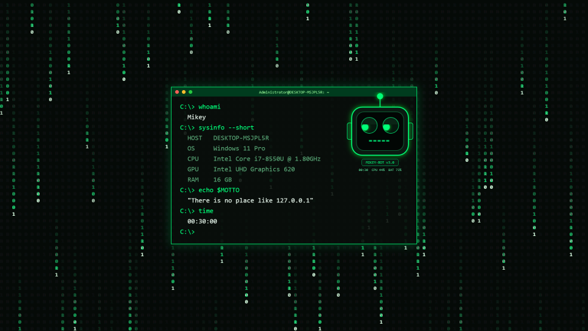
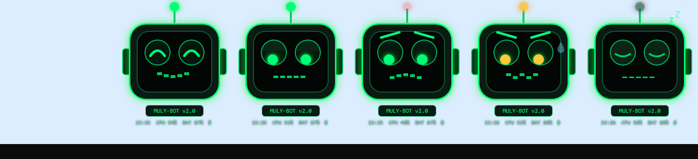
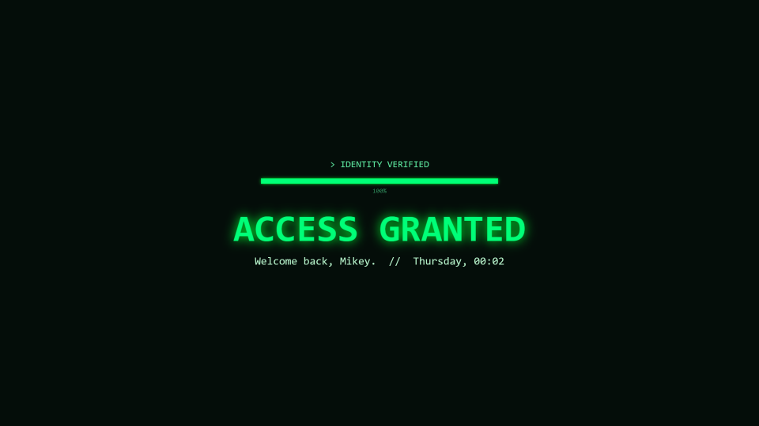
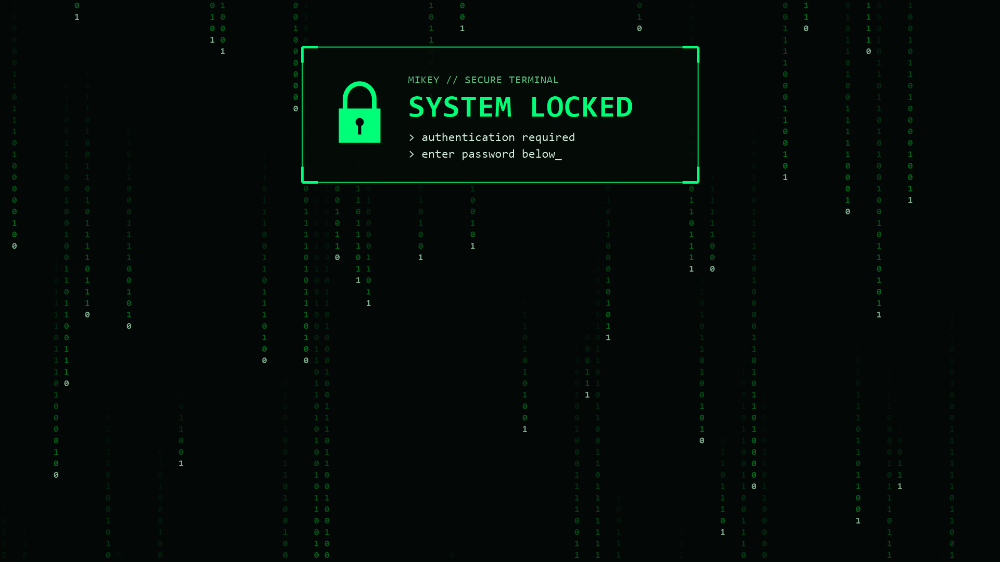

# MIKEY Desktop 🟢 `> whoami`

A hacker-style makeover for Windows 11, built around **MIKEY-BOT**: a desktop robot whose eyes follow your cursor and who reacts to what your PC is doing. It's all PowerShell, C# and HTML. Nothing here needs compiling ahead of time, and the installer builds the rest.



## Features

| | |
|---|---|
| 🤖 **MIKEY-BOT** | Transparent desktop robot. Eyes track your mouse, it blinks, and its antenna pulses. Drag it anywhere. |
| 😴 **Moods** | Happy when you double-click it. Sleepy after 11 pm. Falls asleep (Zzz) after 3 min idle. Sweats when CPU > 85 %. Gets worried when battery < 20 %. |
| 📊 **Status line** | Live clock, CPU %, battery % and a ⚡ while charging. |
| ⏰ **Break reminders** | Tells you to take a break after 2 hours of non-stop use. |
| 🗣️ **Aria voice** | The bot talks with Microsoft's *Aria* neural voice (pre-recorded with [edge-tts](https://github.com/rany2/edge-tts)). |
| 🌧️ **Live wallpaper** | Falling binary rain + a terminal that types itself out and shows a live clock ([Lively Wallpaper](https://github.com/rocksdanister/lively)). |
| 🔓 **ACCESS GRANTED** | Full-screen hacker splash + voice right after you sign in or unlock. |
| 🔒 **Lock screen** | "SYSTEM LOCKED" binary-rain image; optionally skips the clock screen. |
| 💤 **Screensaver** | Binary rain with an idle clock HUD (`MatrixRain.scr`). |
| 💻 **Shell** | Hacker PowerShell prompt with an ASCII banner, plus a green Matrix theme for Windows Terminal. |
| 📁 **Folder icons** | Neon `>_` icon for your code folders. |

<p align="center">
  <br>
  <em>Moods: happy · sleepy · worried (low battery) · stressed (high CPU) · asleep</em>
</p>

| ACCESS GRANTED (sign-in / unlock) | Lock screen |
|---|---|
|  |  |

## Requirements

- Windows 10/11 with Windows PowerShell 5.1 (built in)
- .NET Framework 4.x (built in), used to compile the screensaver
- Optional:
  - **Python 3** for the Aria voice. Without it the bot works but stays silent.
  - [**Lively Wallpaper**](https://github.com/rocksdanister/lively) for the animated wallpaper: `winget install rocksdanister.LivelyWallpaper`
  - [**TranslucentTB**](https://github.com/TranslucentTB/TranslucentTB) for a fully transparent taskbar: `winget install CharlesMilette.TranslucentTB`

## Install

```powershell
git clone https://github.com/<you>/mikey-desktop.git
cd mikey-desktop
powershell -ExecutionPolicy Bypass -File .\install.ps1
```

Run it from an **elevated** PowerShell (Run as administrator) to also set the lock screen.

| Option | What it does |
|---|---|
| `-Name Neo` | Renames the bot and user everywhere (`NEO-BOT`, *"Hello, Neo"*, …). Letters only. |
| `-NoLockClock` | Skips the lock-screen clock: lock or wake goes straight to the password box (admin). |
| `-DesktopTweaks` | Dark mode, neon-green accent, hidden desktop icons. |
| `-IconFolders C:\code\a, C:\code\b` | Puts the `>_` icon on those folders. |
| `-SkipVoice` `-SkipScreensaver` `-SkipWallpaper` `-SkipLockScreen` `-SkipProfile` `-SkipTerminalTheme` `-SkipAutostart` | Leaves that part out. |
| `-InstallDir <path>` | Where the app is installed (default `%USERPROFILE%\DesktopBot`). |

What the installer does:
1. Copies `app\` to the install folder.
2. Records the voice clips.
3. Builds and sets the screensaver.
4. Sets the static and live wallpaper.
5. Sets the lock screen.
6. Installs the PowerShell profile (it backs up your old one).
7. Adds the Terminal theme (it backs up `settings.json`).
8. Sets up autostart: a Startup-folder launcher for the bot, plus a sign-in scheduled task that starts the ACCESS GRANTED watcher. The watcher keeps its window pre-built in the background, so the splash appears within about half a second of unlocking.

## Using MIKEY-BOT

| Action | How |
|---|---|
| Move it | Left-drag |
| Make it talk | Double-click |
| Menu | Right-click: always on top, voice on/off, say something, show all moods, exit |

### Voice lines

All fixed lines live in [`app/voice/phrases.json`](app/voice/phrases.json). Edit them, then re-record:

```powershell
cd $env:USERPROFILE\DesktopBot
.\tts-venv\Scripts\python.exe -I voice\record.py --force
```

To use a different voice, change `VOICE` in `record.py` (e.g. `en-US-JennyNeural`, `en-GB-SoniaNeural`) and re-record.

## Project layout

```
install.ps1 / uninstall.ps1      set up / undo everything
app/
  bot.ps1                        MIKEY-BOT (WPF window, moods, status, animation loop)
  access-granted.ps1             ACCESS GRANTED background watcher (splash at sign-in + instantly on unlock)
  voice/phrases.json, record.py  Aria voice lines + recorder (edge-tts)
  live-wallpaper/                Lively web wallpaper (binary rain + live terminal)
  screensaver/MatrixRain.cs      binary-rain screensaver source
  make-wallpaper.ps1             static wallpaper generator (detects your specs)
  make-lockscreen.ps1            SYSTEM LOCKED lock screen generator (admin)
  make-folder-icon.ps1           neon >_ folder icon (+ applies it to folders)
  refresh-wallpaper.ps1          push edits in live-wallpaper\ into Lively and reload it
powershell/                      hacker PowerShell profile
terminal/matrix-scheme.json      Windows Terminal colour scheme
docs/                            screenshots
```

## Privacy notes

- The bot doesn't use the microphone and doesn't send anything anywhere while running.
- The **voice lines** are synthesised once, at install, by Microsoft's online Edge text-to-speech service (via edge-tts). After that they play fully offline.

## Uninstall

```powershell
.\uninstall.ps1               # undo settings (run elevated to also undo lock-screen changes)
.\uninstall.ps1 -RemoveFiles  # ...and delete the install folder
```

## Credits

- [Lively Wallpaper](https://github.com/rocksdanister/lively) (live wallpaper host)
- [edge-tts](https://github.com/rany2/edge-tts) (Aria neural voice)
- [TranslucentTB](https://github.com/TranslucentTB/TranslucentTB) (transparent taskbar)
